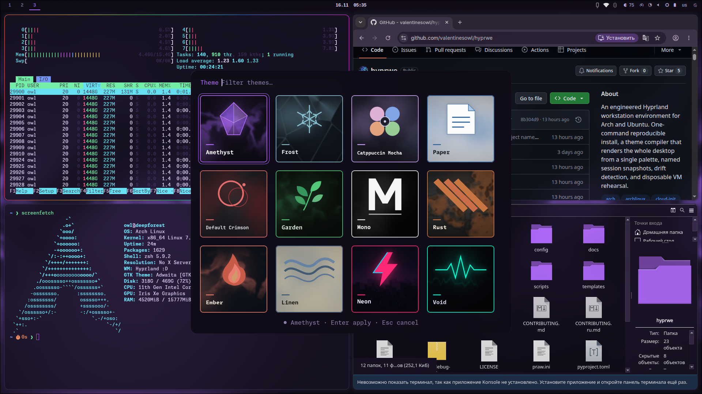
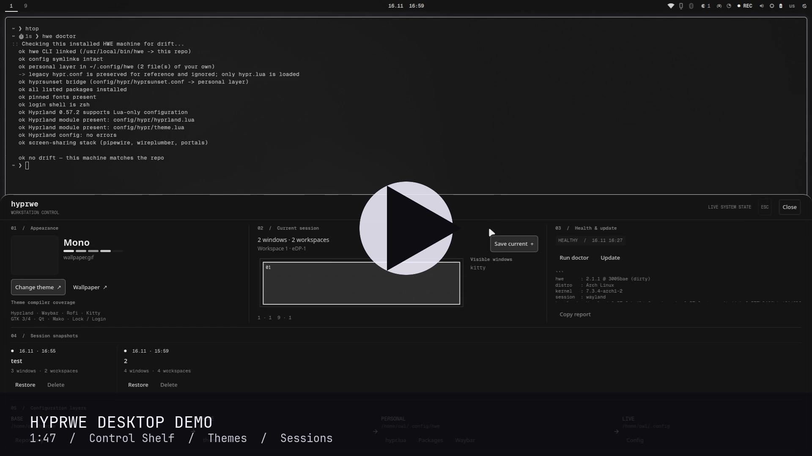
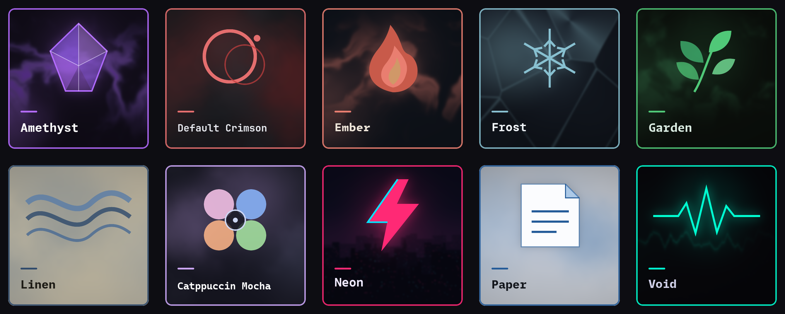

# hyprwe — Hyprland Workstation Environment

**English** · [Русский](README.ru.md)

[](LICENSE)
[](https://archlinux.org)
[](https://ubuntu.com)
[](https://hyprland.org)
[](../../releases/latest)
[](../../actions/workflows/ci.yml)

**A Hyprland workstation you can rehearse, reproduce, and safely update.**

A complete Wayland desktop for Arch and Ubuntu, together with the tooling to install,
inspect, personalize and test it — on a real machine or in a disposable VM.

[Install](#install) · [Try in a VM](#try-in-a-vm) · [Documentation](#documentation)

<p align="center">
  
</p>

## Demo

<a href="https://github.com/valentinesowl/hyprwe/releases/download/v2.2.0/rec_2026-11-16_16-59-05.mp4">
  
</a>

[Open or download the 1:47 demo](https://github.com/valentinesowl/hyprwe/releases/download/v2.2.0/rec_2026-11-16_16-59-05.mp4)

## Why hyprwe

- **A complete desktop** — Hyprland, Waybar, Rofi, Kitty, Mako, Hyprlock, Hypridle and SDDM,
  with coherent defaults and a modular Lua configuration for Hyprland 0.57+.
- **A theme compiler, not a collection of colour files** — one `theme.toml` renders the whole
  desktop. Twelve themes are included, with AA-checked text contrast and live theme switching.
- **Named session snapshots** — save and restore applications, workspaces and window geometry
  with `hwe session`.
- **Personal settings that survive updates** — monitors, keybindings, packages and overrides
  live outside the repository and are never silently rewritten.
- **Safe maintenance** — existing configs are backed up, updates use `--ff-only`, and
  `hwe doctor` reports drift without changing the machine.
- **Disposable VM rehearsal** — deploy a branch or your current uncommitted working tree to
  an Arch or Ubuntu VM through libvirt and cloud-init.

<p align="center">
  
  <br>
  <em>Twelve themes. One semantic palette behind the entire workstation.</em>
</p>

## Install

Arch is the primary target. Ubuntu 27.04 is experimental and requires Hyprland 0.57 or newer.

```bash
git clone https://github.com/valentinesowl/hyprwe.git ~/hwe
cd ~/hwe
./bin/hwe install
```

Run the installer from a **TTY** (`Ctrl+Alt+F2`), not from a running graphical session.
Existing configuration files are preserved as `*.hwe-bak`. Changes to the login shell,
networking and NVIDIA setup can be opted out.

After installation, log in and press `SUPER + SHIFT + Up` for the Control Shelf,
`SUPER + A` for the command center, or `SUPER + /` for the keybinding cheatsheet.

[Installation options, Ubuntu sources, GPU details and rollback →](docs/INSTALL.md)

## Try in a VM

```bash
./bin/hwe doctor vm
./bin/hwe vm up --uncommitted
```

The VM runs the same `hwe install` as a real machine. Your working tree is captured through
a throwaway snapshot: your index, branches and history stay untouched, and nothing needs to
be pushed to GitHub.

For Ubuntu 27.04:

```bash
./bin/build-ubuntu-cloud
HWE_VM_DISTRO=ubuntu ./bin/hwe vm up --uncommitted
```

[VM workflow, image verification and overrides →](docs/VM.md)

## Everyday commands

| Command | What it does |
|---|---|
| `hwe control` | open the live Control Shelf for appearance, sessions and system state |
| `hwe center` | open themes, sessions, health checks, VM rehearsal and desktop tools |
| `hwe theme pick` | choose and apply a theme |
| `hwe session save 1` / `hwe session restore 1` | save or restore a desktop session |
| `hwe update` | pull and reconcile the machine |
| `hwe update --check` | report drift without changing anything |
| `hwe doctor` | check configs, packages, personal layer and session stack |
| `hwe vm ssh` / `hwe vm destroy` | enter or remove the development VM |
| `hwe keys` | show the generated keybinding cheatsheet |

[Full CLI, themes, wallpapers and development reference →](docs/CLI.md)

## Make it yours

Machine-specific settings live in `~/.config/hwe/`, outside the checkout. Custom themes go in
`~/.local/share/hwe/themes/`. Both survive updates and repository replacement.

[Personal layer, monitors, reduced motion and Hyprland modules →](docs/CUSTOMIZATION.md)

## Documentation

| Guide | Contents |
|---|---|
| [Installation and updates](docs/INSTALL.md) | install options, Ubuntu, GPU, rollback, drift detection |
| [Customization](docs/CUSTOMIZATION.md) | personal settings, monitors, Hyprland modules, keybindings |
| [CLI and desktop reference](docs/CLI.md) | commands, sessions, themes, wallpapers, repository layout |
| [Disposable VMs](docs/VM.md) | cloud-init, uncommitted snapshots, image verification |
| [Writing a theme](themes/README.md) | semantic roles, typography, wallpaper styles |
| [Contributing](CONTRIBUTING.md) | development workflow, quality gates and tests |
| [Changelog](CHANGELOG.md) | what changed in each release |

## Status

`v2.2.0` is the current release. Arch with Hyprland 0.57.2 is the verified reference target;
Ubuntu 27.04 remains experimental and has not passed the full release VM matrix.
NVIDIA setup is still unverified on real hardware.

The full suite currently covers **982 Python tests and 321 Bats tests**, with clean Arch and
Ubuntu VM deployments verified end-to-end in their tested x86_64 libvirt/QEMU configurations.

## License

[GPL-3.0](LICENSE) © 2026 valentinesowl.

Inspired by the author's own AwesomeWM system and by [HyDE](https://github.com/HyDE-Project/HyDE).
