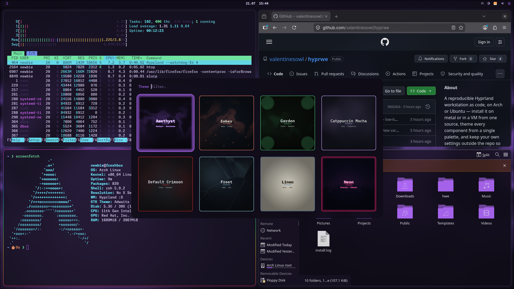
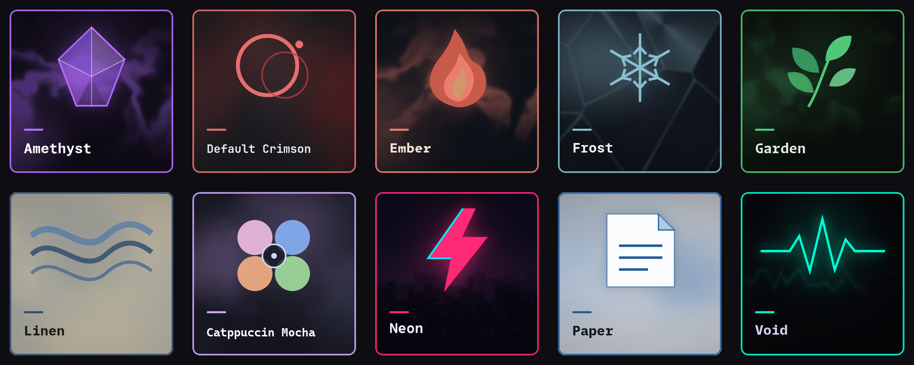

# Hyprland Workstation Environment (HWE)

**English** · [Русский](README.ru.md)

[](LICENSE)
[](https://archlinux.org)
[](https://ubuntu.com)
[](https://hyprland.org)
[](../../releases/latest)
[](../../actions/workflows/ci.yml)

**A working environment on Arch and Ubuntu — Hyprland and everything around it: bar,
launcher, notifications, themes, login screen.** It installs with one command and deploys
the same way on bare metal (`hwe install`) and on a disposable VM (`hwe vm up`), from one
source.

<p align="center">
  
  <br>
  <em>A stock install, minutes old — the <code>amethyst</code> theme colouring every component at once: bar, terminal, Qt file manager, and the theme picker choosing what comes next.</em>
</p>

The environment is described in full inside the repository and reproduces on any machine
from that description. Colours, geometry and fonts of every component are rendered from a
single palette file (`themes/<name>/theme.toml`) — the same mechanism that gives you
reproducibility keeps the whole stack in one tone.

- **Theme engine** — one `theme.toml` sets the colours of every component at once;
  `hwe theme apply` changes the desktop live. Ten themes included.
- **Modular Hyprland config** — Lua `require` modules for Hyprland 0.57, alongside
  kitty, waybar, rofi, mako, hyprlock and hypridle.
- **Dev VM in one command** — `hwe vm up` brings up an Arch or Ubuntu VM through
  `libvirt`/`virt-install` (visible in virt-manager), provisions it with `cloud-init`
  and deploys your chosen local git branch straight from your own repository.

<p align="center">
  
  <br>
  <em>Ten built-in themes (eight dark + two light: <code>paper</code> and the softer <code>linen</code>) — each one is a single <code>theme.toml</code> the whole stack is rendered from.</em>
</p>

---

## Documentation

| Document | What is in it |
|---|---|
| [`themes/README.md`](themes/README.md) | writing a theme: the `[sem]` role contract, `[params]`, typography, wallpaper styles |
| [`CONTRIBUTING.md`](CONTRIBUTING.md) | development workflow, quality gates, tests, how colour flows through the repo |
| [`CHANGELOG.md`](CHANGELOG.md) | what changed in each version |
| [`LICENSE`](LICENSE) | GPL-3.0 |

Everything below is the tour: install it, run it, hack on it.

---

## Installation

Installing onto an Arch or Ubuntu machine is one command: the installer adds packages,
deploys the configs and sets up the login screen. It does so **reversibly**, preserving
whatever is already on the machine.

```bash
# 1. Clone the repository  (a minimal system has no git yet:
#    sudo pacman -S git  /  sudo apt install git)
git clone https://github.com/valentinesowl/hyprwe.git ~/hwe
cd ~/hwe

# 2. Switch to a TTY (Ctrl+Alt+F2) and roll HWE out onto this machine.
#    The installer refuses to start from a graphical session: it touches the
#    compositor, the bar and the login shell — not something to do under a running Hyprland.
./bin/hwe install
```

What `hwe install` does:

- installs `pkg/core.lst` + `pkg/dev.lst` from the distribution's repositories (on Ubuntu
  the names go through `pkg/map/apt.map`); on Arch, `paru` is bootstrapped if `pkg/aur.lst`
  is non-empty — AUR entries are skipped on Ubuntu, with a notice;
- symlinks `config/*` into `~/.config`, **keeping** your previous configs beside them as `*.hwe-bak`;
- generates and applies the default theme (`mocha`);
- makes `zsh` the login shell and enables NetworkManager + SDDM (the login screen).

**GPU.** Intel/AMD work out of the box — mesa comes along with Hyprland, the drivers are
in-tree, there is nothing to configure. **NVIDIA** is detected by the installer via `lspci`
and set up for you — on Arch only; on Ubuntu it says so and leaves the GPU alone. The setup:
driver (open modules for Turing+, proprietary for older cards),
DRM modesetting, initramfs modules and a pacman rebuild hook. That touches boot, so it asks
for confirmation — and, honestly: **this path has not yet been tried on live NVIDIA hardware**
(development happened on Intel). `HWE_NO_NVIDIA=1` skips it entirely; `HWE_NVIDIA_DRIVER=<package>`
pins the driver if the generation detection guessed wrong. `hwe uninstall` does **not** roll
that layer back (initramfs/modules).

Careful and predictable:

- **A system upgrade is opt-in.** The full upgrade (`pacman -Su` / `apt-get upgrade`) runs
  only with `HWE_FULL_UPGRADE=1`; otherwise the install works against the current package
  database (on Ubuntu the package lists are still refreshed — apt needs that before any install).
- **Opt-outs:** `HWE_NO_ZSH=1` (leave the shell alone), `HWE_NO_NM=1` (leave networking alone),
  `HWE_NO_NVIDIA=1` (leave the GPU alone), `HWE_FORCE=1` (run even from a graphical session — at your own risk).
- **Unattended:** `HWE_ASSUME_YES=1` answers yes to every confirmation (install preflight,
  NVIDIA, package sync, VM teardown). It deliberately does **not** cover the PPA compositor
  consent (`HWE_HYPR_SOURCE=ppa`) — a blanket yes should not hand a third party's key that reach.
- **Rollback:** `hwe uninstall` restores your previous configs from `*.hwe-bak` and offers to
  revert the login shell (it asks first); packages and services stay in place — you cannot
  lock yourself out.
- Minor knobs: `NO_COLOR=1` disables colour output; `HWE_DEFAULT_THEME=<name>` sets which
  theme the install applies (default `mocha`).

After the install `hwe` is linked into `/usr/local/bin/hwe` — from then on you just call
`hwe …` (before the install — `./bin/hwe …`). The first login greets you and points at
`SUPER + /`, the keybinding cheatsheet.

> Configs are deployed as **symlinks** into the repository: edit `~/hwe/config/...` and the
> change is live right away. Settings of your own belong in `~/.config/hwe/` instead —
> see [Your own settings](#your-own-settings).

### On Ubuntu

Lua-only HWE 2.0 targets **Ubuntu 27.04 experimentally** and requires
**Hyprland 0.57.0 or newer** (0.57.2 is recommended). This target has not yet passed the
release VM matrix. **Ubuntu 26.04 is not supported by HWE 2.0**: its archive candidate is
0.53.3, so installation stops before packages, configs, shell or services are changed.
For Hyprland 0.53–0.56, use the HWE 1.4.x `legacy-conf` line instead.

**Where the compositor comes from is your decision, and HWE will not make it quietly.**

| `HWE_HYPR_SOURCE` | Requirement | What you grant |
|---|---|---|
| `repo` *(default)* | Ubuntu's candidate must be >= 0.57.0 | nothing new — the machine already trusts its distribution |
| `ppa` | the explicit third-party candidate must also be >= 0.57.0 | a stranger's signing key, confined by apt pinning to the Hyprland stack |

```bash
hwe install                        # use Ubuntu's candidate, after the version gate
HWE_HYPR_SOURCE=ppa hwe install    # explicitly opt in to the third-party archive
```

A PPA is not assumed to contain a suitable release: HWE checks its candidate after updating
the package metadata and refuses it if it is too old. Adding a third-party archive ordinarily
hands its key the right to install *any* package; HWE pins it to the compositor stack alone.
Setting `HWE_HYPR_SOURCE=ppa` **is** the consent and is not covered by `HWE_ASSUME_YES`.
Building the compositor from source is not offered, and HWE never switches sources to make
the version check pass.

Ubuntu packages can enable systemd *user* units on installation. HWE starts the session
programs from `config/hypr/autostart.lua`, so duplicate packaged units are stood down.
Other package availability differences are recorded in `pkg/map/apt.map`; the map must be
revalidated against Ubuntu 27.04 before that target is declared stable.

### Keeping a machine in sync

```bash
hwe update            # pull the repo and reconcile this machine
hwe update --check    # read-only: report drift, change nothing
hwe doctor            # same read-only check (bare doctor = doctor host)
hwe doctor vm         # host prerequisites for the VM workflow instead
hwe doctor --report   # the same check as one paste-ready block for an issue
```

`hwe update` pulls with `--ff-only` and stops if the tree is dirty or the history has
diverged — it will never silently merge or stash your work. Then it relinks the configs,
re-applies the current theme and offers to install packages that are missing from the
lists. `hwe doctor` reports the same drift without touching anything: config symlinks,
packages, the personal layer, login shell, Hyprland config errors, the screen-sharing
stack (pipewire, wireplumber, the portals). Detection and repair
share the install primitives, so a check cannot drift from what the installer actually
lays down.

---

## Your own settings

Some things cannot come from the repository, because they are not the same twice: your
displays, the keys your hands already know, the packages this particular machine needs.
Those live in `~/.config/hwe/` — **outside the checkout**, created for you on install and
never rewritten afterwards.

| File | What it holds |
|---|---|
| `hypr.lua` | displays, input, keybinds — required **last**, so it overrides what HWE ships |
| `packages.lst` | extra packages for this machine (the distribution's own) |
| `packages-aur.lst` | the same, from the AUR (Arch; skipped on Ubuntu) |
| `waybar.jsonc` | your bar's composition — merged over the generated config on every theme apply |
| `hyprsunset.conf` | your night-light schedule (when and how warm) — `hwe sunset` toggles it |
| `kanshi.conf` | your monitor profiles — dock and the layout follows, undock and it snaps back |
| `themes/` | HWE's own notes per theme — which theme is applied, which wallpaper each one uses. Written by `hwe`, so replacing the checkout forgets nothing |

```bash
$EDITOR ~/.config/hwe/hypr.lua    # your monitors go here, not in config/hypr/monitors.lua
hyprctl reload                     # SUPER+SHIFT+R
```

For a laptop that meets a dock, `kanshi.conf` is the better home for the monitors: a
profile applies the moment its outputs are all connected. One owner per output though —
a display managed by kanshi should not also have an `hl.monitor` call in `hypr.lua`.

**Upgrading from HWE 1.4:** an untouched legacy `hypr.conf` gains a new `hypr.lua`
automatically. If you changed `hypr.conf`, `hwe update` stops before deployment until you
create `hypr.lua` yourself. The old file is preserved for reference and is never executed
or deleted by HWE. See the skeleton for `hl.monitor`, `hl.config`, `hl.bind` and
`hyprland.start` examples. The other Hypr* tools (`hypridle`, `hyprlock`, `hyprpaper` and
`hyprsunset`) still use their `.conf` files.

The location is the whole point. `config/` is deployed as symlinks into the repository, so
tuning something in place would be an edit to a **tracked file** — and `hwe update` refuses
to pull onto a dirty tree. Personalising the environment would cost you the ability to
update it. Kept here instead, `git status` stays clean whatever you change, a pull can never
conflict with your setup, and replacing the checkout does not take it with you.

The same rule holds one level up: a theme of your own goes in
`~/.local/share/hwe/themes/<name>/`, where it shadows a shipped theme of the same name.

`hwe doctor` states what you have made your own and never calls it drift. The one thing it
does report is a **missing** file — `hwe update` puts it back. A file you have edited is
never rewritten; one you have *not* quietly keeps up with the shipped defaults (HWE knows
every default it ever shipped, so it can tell the two apart). And if you want the defaults
back after all: `hwe update --reset-defaults` restores them, keeping your versions beside
them as `*.hwe-bak`.

---

## CLI: `hwe`

| Command | What it does |
|---|---|
| `hwe install` | install packages and deploy configs onto **this** machine |
| `hwe update [--check]` | pull the repo and reconcile this machine (configs, theme, packages) |
| `hwe uninstall` | revert config symlinks and login shell (packages/services stay) |
| `hwe theme <list\|apply\|pick\|validate\|current\|sddm>` | render every component's colours from a theme |
| `hwe wall <list\|set\|random\|pick\|current\|restore>` | wallpaper (generated by the theme, or your own photos) |
| `hwe power` | rofi session menu (lock/logout/suspend/reboot/shutdown) |
| `hwe keys` | keybinding cheatsheet (rofi, generated from the binds; `SUPER+/`) |
| `hwe clip <show\|wipe>` | clipboard history (cliphist, rofi; `SUPER+C`) |
| `hwe record <toggle\|region>` | screen recording (wf-recorder → `~/Videos`; bar indicator) |
| `hwe sunset <toggle\|on\|off\|status>` | night light (hyprsunset; the moon at the bar's right edge) |
| `hwe checkconfig [--notify]` | verify the Lua config and running Hyprland errors |
| `hwe vm <up\|ssh\|console\|status\|list\|down\|destroy\|rebuild>` | the local dev VM (libvirt + cloud-init) |
| `hwe doctor [host\|vm\|--report]` | health-check this machine (host, the default) or the VM prerequisites; `--report` = issue-ready block |
| `hwe session <save\|restore\|list\|clear>` | named snapshots of every application, workspace and window position |
| `hwe version` | print the version (from `bin/hwe`) |

### Named session snapshots

```bash
hwe session save 1       # save every window and workspace to slot 1
hwe session restore 1    # restore that session
hwe session list         # names, dates and snapshot sizes
hwe session clear 1      # delete one snapshot
hwe session clear --all  # delete all snapshots (with confirmation)
```

A snapshot covers every mapped window, workspace and monitor, including the active
workspace and tiled window geometry. Restore reuses matching open applications, launches
missing ones and applies positions through a Lua layout provider without making windows
floating. It does not close your current windows. Nothing is saved or restored automatically.

Snapshots live in `~/.local/state/hwe/sessions/` and are written atomically with mode `0600`.
Window titles, PIDs and command-line arguments are not persisted. Application-internal state
(browser tabs, terminal processes and unsaved documents) belongs to those applications, not
to the snapshot.

---

## Themes

A theme is **one** file, `themes/<name>/theme.toml`: a private `[palette]` and the semantic
`[sem]` contract (~19 roles: `bg_*`, `fg_*`, `accent`, `red`/`green`/…, `border`, `urgent`).
The templates in `templates/*.j2` read **roles only**, so a new theme comes down to a single
`theme.toml`.

```bash
hwe theme list                # available themes (the current one is marked *)
hwe theme apply mocha         # render + deploy + live reload of every component
hwe theme pick                # rofi gallery with previews (SUPER+SHIFT+T)
hwe theme validate <name>     # check a theme against the contract (fail-loud)
```

The separate `[font]` table is a contract too: the font family and sizes for each surface
(`terminal`/`bar`/`launcher`/`notify`/`gtk`), with fallback defaults. Change the font size
right in the theme — see [`themes/README.md`](themes/README.md#typography-font).

`theme apply` renders colours into hyprland, waybar, kitty, rofi, mako, GTK 3/4, Kvantum
(Qt/KDE), starship, kdeglobals and hyprlock; then it makes the running applications reread
them and sets the theme's wallpaper. The SDDM greeter is synced separately (needs root):
`hwe theme sddm`.

**Themes included:** `amethyst` · `default` · `ember` · `frost` · `garden` · `mocha` (the
default) · `neon` · `paper` (light) · `linen` (soft light) · `void`. To add your own, see
[`themes/README.md`](themes/README.md).

### Wallpapers

```bash
hwe wall pick                 # rofi with thumbnails (SUPER+SHIFT+W)
hwe wall random [theme]       # a random wallpaper of the theme
hwe wall set <path|name>      # a specific file, or a name from `wall list`
```

Every theme carries a **generated** `wallpaper.png` (our own, no licences attached):
procedural art in one of six styles — see `themes/README.md`. Put your own photos into
`themes/<name>/wallpapers/` (it is in `.gitignore`) and they show up next to it.

---

## The Hyprland config

The entry point is `config/hypr/hyprland.lua`, which requires each module separately:

| File | What it covers |
|---|---|
| `environment.lua` | session environment variables |
| `monitors.lua` | the fallback output rule (**yours** go in `~/.config/hwe/hypr.lua`) |
| `appearance.lua` | general / decoration / blur / curves / animations |
| `theme.lua` | **generated** — border, geometry, opacity and animation speed |
| `input.lua` | keyboard (us/ru), touchpad, gestures |
| `keybindings.lua` | described keybinds (SUPER; focus on the arrows; no duplicates) |
| `windowrules.lua` | window and layer rules |
| `session-layout.lua` | Lua layout provider for exact session restore |
| `autostart.lua` | one `hyprland.start` handler for session programs |

And last of all, `~/.config/hwe/hypr.lua` — yours, outside the repository, overriding
everything above it.

Plus `hypridle.conf` (idle → lock/DPMS) and `hyprlock.conf` (generated). On every login
`hwe checkconfig --notify` puts syntax errors on screen, should Hyprland change its grammar.

**The main binds:**
`SUPER+T` terminal · `SUPER+N` files · `SUPER+B` browser · `SUPER+R` launcher (rofi) ·
`SUPER+Q` close · `SUPER+V` floating · `SUPER+F` fullscreen · `SUPER+←↑↓→` focus ·
`SUPER+SHIFT+←↑↓→` move the window · `SUPER+1..0` workspaces · `SUPER+X` scratchpad ·
`SUPER+S` then `1..9` save session · `SUPER+S` then `SHIFT+1..9` restore session ·
`SUPER+L` / `SUPER+Escape` lock · `SUPER+Space` us↔ru layout ·
`SUPER+SHIFT+T` theme · `SUPER+SHIFT+W` wallpaper · `SUPER+SHIFT+E` power menu ·
`SUPER+/` bind cheatsheet · `SUPER+C` clipboard · `SUPER+SHIFT+C` colour picker ·
`SUPER+ALT+R` / `SUPER+ALT+S` screen recording (whole / region) ·
`Print` screenshot → clipboard · `SHIFT+Print` region → clipboard ·
`SUPER+Print` region → `~/Pictures` ·
`SUPER+SHIFT+Print` / `SUPER+P` region with annotation (satty) → `~/Pictures`.

---

## Sandbox and development (VM)

Want to try HWE on a separate, disposable machine — or to develop HWE itself? `hwe vm up`
brings up a **disposable** Arch **or Ubuntu** VM (`HWE_VM_DISTRO`, visible in virt-manager)
and deploys **your local git branch** into it, straight from your own repository. Inside, the
very same `hwe install` runs as on bare metal, so it is an honest rehearsal of the installation.

```bash
# 0. Check the host (libvirtd, groups, network, KVM)
./bin/hwe doctor vm

# 1. Bring up a VM with the current branch (or name one)
./bin/hwe vm up
./bin/hwe vm up feature-x

# 1b. Or deploy the working tree as it is, before committing anything
./bin/hwe vm up --uncommitted

# 2. Get inside (once cloud-init has finished)
./bin/hwe vm ssh
./bin/hwe vm console      # or watch it boot in virt-manager
./bin/hwe vm status       # state + IP

# 3. Rebuild from scratch / tear down
./bin/hwe vm rebuild
./bin/hwe vm destroy
```

By default the VM gets the branch's last commit. `--uncommitted` deploys the working tree
instead — modified, staged, deleted and new files included — so a change can be tested
before it is committed. The snapshot is built through a separate index and a temporary
`--shared` clone: your index, working tree and branches do not move, and no commit appears
in your history. Ignored files stay behind; the guest regenerates them.

Logging into the VM: user **`hwe`**, password **printed by `vm up`** (random, per build).
Your `~/.ssh/id_*.pub` keys are passed into the guest automatically — normally you log in
by key, and the password is left for the console only.

Configs inside the VM are deployed as **symlinks** into the repository, so edits in
`~/hwe/config/...` are visible immediately — handy when developing HWE itself.

### How it works

1. `hwe vm up <branch>` downloads the guest's cloud image into `~/.cache/hwe/` (once, a few
   hundred MB) and **verifies its GPG signature** — against the pinned arch-boxes fingerprint
   for Arch, or the Ubuntu cloud-image signing key (a signed `SHA256SUMS`) for Ubuntu. An image
   HWE cannot authenticate is refused, never used.
2. It makes a `git bundle` of the chosen branch — or, with `--uncommitted`, of a throwaway
   snapshot of your working tree — and puts it on a **NoCloud seed ISO** (`xorriso`).
3. `virt-install --import` creates a **libvirt domain** (visible in virt-manager).
4. `cloud-init` in the guest creates the user, mounts the seed, does a `git clone` from the
   bundle and runs `hwe install` — the machine brings itself up, from image to finished desktop.

### Overrides (env)

| Variable | Default | Purpose |
|---|---|---|
| `HWE_VM_DISTRO` | `arch` | guest distribution: `arch` or `ubuntu` |
| `HWE_VM_UBUNTU_RELEASE` | `27.04` | experimental Ubuntu release to fetch (when `HWE_VM_DISTRO=ubuntu`) |
| `HWE_HYPR_SOURCE` | `repo` | where the guest's Hyprland comes from: `repo` or `ppa` |
| `HWE_VM_NAME` | per distro | libvirt domain name (`hwe-dev`, `hwe-dev-ubuntu`) |
| `HWE_VM_MEMORY` | `4096` | RAM, MiB |
| `HWE_VM_VCPUS` | `4` | vCPUs |
| `HWE_VM_DISK_SIZE` | `24G` | root disk size |
| `HWE_VM_USER` | `hwe` | user name in the guest |
| `HWE_VM_PASSWORD` | *random* | password (set it to pin one) |
| `HWE_LIBVIRT_URI` | `qemu:///system` | libvirt URI (the virt-manager default) |
| `HWE_VM_NETWORK` | `default` | libvirt network name |
| `HWE_IMAGE_URL` | per distro | base image (signed; an unverifiable one is refused) |

---

## Repository layout

```
hyprwe/
├── bin/hwe                 # the one CLI: vm · install · update · theme · wall · power · keys · clip · record · checkconfig · doctor
├── lib/
│   ├── common.sh           # logging, confirm, need, run
│   ├── vm.sh               # virt-install + cloud-init + git bundle
│   ├── theme.sh            # hwe theme — render the palette into every component
│   ├── wall.sh             # hwe wall — wallpaper (per theme, live swap)
│   ├── update.sh           # hwe update — ff-only pull + reconcile the machine
│   ├── doctor.sh           # hwe doctor — drift check for the machine (and the VM host)
│   ├── power.sh            # hwe power — rofi session menu
│   ├── keys.sh             # hwe keys — bind cheatsheet (rofi)
│   ├── clip.sh             # hwe clip — clipboard history (cliphist)
│   ├── record.sh           # hwe record — screen recording (wf-recorder)
│   ├── sunset.sh           # hwe sunset — night light (hyprsunset)
│   ├── session.sh          # hwe session — named desktop snapshots
│   ├── checkconfig.sh      # hwe checkconfig — Hyprland config errors
│   └── welcome.sh          # hwe welcome — greeting on the first login
├── provision/
│   ├── cloud-init/         # user-data.tmpl, meta-data.tmpl (@@VAR@@ tokens)
│   ├── guest-install.sh    # installs packages + deploys configs (guest and bare metal alike)
│   ├── userlayer/          # skeletons of ~/.config/hwe — copied once, never overwritten
│   ├── sddm/hwe/           # the SDDM QML greeter (themed from the active palette)
│   ├── hyprland-uwsm.desktop  # the Hyprland (uwsm) session for SDDM
│   └── *.asc               # pinned signing keys of the cloud images (arch-boxes, Ubuntu)
├── pkg/                    # core.lst · dev.lst · vm.lst · aur.lst · fonts.lock · map/
├── themes/<name>/          # theme.toml (palette + [sem]) + wallpaper.png + preview.png
├── templates/              # .j2 — every component's colours are rendered from [sem]
├── config/                 # XDG configs → symlinked into ~/.config
│   ├── hypr/               # the modular Hyprland (see hyprland.lua)
│   ├── kanshi/             # monitor hotplug profiles (the profiles themselves: ~/.config/hwe)
│   ├── waybar/ rofi/ mako/ kitty/ gtk-3.0/ gtk-4.0/ zsh/
│   └── starship.toml
├── scripts/                # render-theme.py · genwall.py · genpreview.py · wbstat.py
├── tests/                  # pytest (theme engine, generators, repo hygiene) + bats/ (bash)
├── .github/workflows/      # ci.yml (PR gates) · release.yml (tag vX.Y.Z → release)
├── CHANGELOG.md            # the version lives in bin/hwe; tag and CHANGELOG are cross-checked in CI
└── justfile                # dev tasks (just up / ssh / check / walls …)
```

## Development

```bash
just            # list the tasks
just up         # = hwe vm up
just check      # everything CI checks: linters + tests (see CONTRIBUTING.md)
just test       # tests only: pytest + bats
just lint       # shellcheck over every script
just fmt        # shfmt (4 spaces; not a gate)
just walls      # regenerate the wallpapers of every theme
just previews   # regenerate the theme previews (for the rofi gallery)
just gallery    # rebuild assets/themes.png from the previews
```

The quality gates are installed along with everything else by `hwe install` (`pkg/dev.lst`),
and CI installs exactly the same ones — so a green `just check` locally means a green
pipeline. How to contribute — [CONTRIBUTING.md](CONTRIBUTING.md).

---

## Status

`v2.0.2` is the current release. HWE is Lua-only on Hyprland 0.57+ and no longer ships
legacy compositor configs. Arch with Hyprland 0.57.2 is the verified reference target;
Ubuntu 27.04 remains experimental and has not passed the full release VM matrix.
NVIDIA setup is still unverified on real hardware.

## Acknowledgements

Inspired by the author's own system for AwesomeWM and by
[HyDE](https://github.com/HyDE-Project/HyDE) — thank you for the ideas.

## License

[GPL-3.0](LICENSE) © 2026 valentinesowl.

The wallpapers and theme previews (`themes/*/wallpaper.png`, `themes/*/preview.png`) are
generated by the repository's own scripts and ship under the same license. Personal photos
in `themes/*/wallpapers/` stay local (see `.gitignore`).
