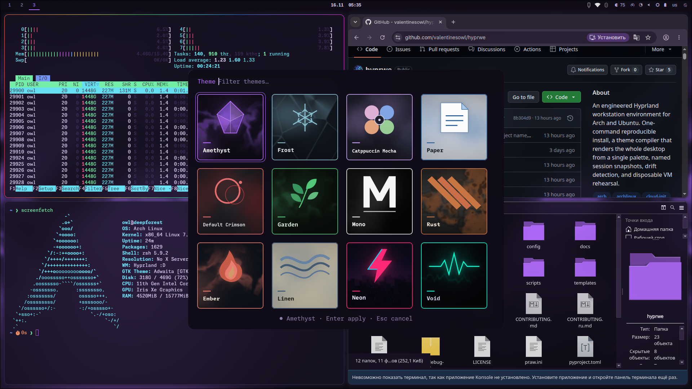
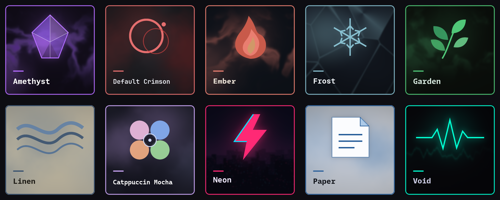

# hyprwe — Hyprland Workstation Environment

[English](README.md) · **Русский**

[](LICENSE)
[](https://archlinux.org)
[](https://ubuntu.com)
[](https://hyprland.org)
[](../../releases/latest)
[](../../actions/workflows/ci.yml)

**Рабочая станция Hyprland, которую можно репетировать, воспроизводить и безопасно обновлять.**

Полноценный Wayland desktop для Arch и Ubuntu вместе с инструментами установки, диагностики,
персонализации и проверки — на реальной машине или в одноразовой VM.

[Установка](#установка) · [Попробовать в VM](#попробовать-в-vm) · [Документация](#документация)

<p align="center">
  
</p>

## Демо

<video src="https://github.com/user-attachments/assets/647d22e4-23b5-49fe-a956-6011b5689933" controls muted playsinline poster="assets/demo-preview.png" width="100%"></video>

[Открыть или скачать демо (1:47)](https://github.com/valentinesowl/hyprwe/releases/download/v2.2.0/rec_2026-11-16_16-59-05.mp4)

## Почему hyprwe

- **Полноценный desktop** — Hyprland, Waybar, Rofi, Kitty, Mako, Hyprlock, Hypridle и SDDM,
  с согласованными настройками и модульной Lua-конфигурацией для Hyprland 0.57+.
- **Компилятор тем, а не набор цветовых файлов** — один `theme.toml` рендерит весь desktop.
  Двенадцать встроенных тем, контраст текста по AA и переключение на лету.
- **Именованные снимки сессий** — сохранение и восстановление приложений, воркспейсов и
  геометрии окон через `hwe session`.
- **Личные настройки переживают обновления** — мониторы, бинды, пакеты и переопределения
  живут вне репозитория и никогда молча не переписываются.
- **Безопасное сопровождение** — прежние конфиги сохраняются, обновления идут через
  `--ff-only`, а `hwe doctor` показывает расхождения, ничего не меняя.
- **Репетиция в одноразовой VM** — развёртывание ветки или текущего незакоммиченного дерева
  в Arch- или Ubuntu-виртуалку через libvirt и cloud-init.

<p align="center">
  
  <br>
  <em>Двенадцать тем. Одна семантическая палитра для всей рабочей станции.</em>
</p>

## Установка

Основная цель — Arch. Ubuntu 27.04 экспериментальна и требует Hyprland 0.57 или новее.

```bash
git clone https://github.com/valentinesowl/hyprwe.git ~/hwe
cd ~/hwe
./bin/hwe install
```

Запускай установщик из **TTY** (`Ctrl+Alt+F2`), а не из работающей графической сессии.
Прежние конфиги сохраняются как `*.hwe-bak`. Изменения login-shell, сети и настройки NVIDIA
можно отключить.

После установки войди в сессию и нажми `SUPER + SHIFT + Up` для Control Shelf,
`SUPER + A` для командного центра или `SUPER + /` для шпаргалки по горячим клавишам.

[Опции установки, источники Ubuntu, GPU и откат →](docs/INSTALL.ru.md)

## Попробовать в VM

```bash
./bin/hwe doctor vm
./bin/hwe vm up --uncommitted
```

VM запускает тот же `hwe install`, что и реальная машина. Рабочее дерево передаётся через
одноразовый снимок: индекс, ветки и история не меняются, а публиковать что-либо на GitHub
не требуется.

Для Ubuntu 27.04:

```bash
./bin/build-ubuntu-cloud
HWE_VM_DISTRO=ubuntu ./bin/hwe vm up --uncommitted
```

[VM-воркфлоу, проверка образов и переопределения →](docs/VM.ru.md)

## Основные команды

| Команда | Что делает |
|---|---|
| `hwe control` | открыть живую Control Shelf для внешнего вида, сессий и состояния системы |
| `hwe center` | открыть темы, сессии, диагностику, VM и утилиты рабочего стола |
| `hwe theme pick` | выбрать и применить тему |
| `hwe session save 1` / `hwe session restore 1` | сохранить или восстановить сессию |
| `hwe update` | подтянуть репозиторий и привести машину в соответствие |
| `hwe update --check` | показать расхождения, ничего не меняя |
| `hwe doctor` | проверить конфиги, пакеты, личный слой и стек сессии |
| `hwe vm ssh` / `hwe vm destroy` | войти в VM или удалить её |
| `hwe keys` | открыть шпаргалку по горячим клавишам |

[Полный справочник CLI, темы, обои и разработка →](docs/CLI.ru.md)

## Сделать окружение своим

Настройки конкретной машины живут в `~/.config/hwe/`, вне checkout. Собственные темы — в
`~/.local/share/hwe/themes/`. И то и другое переживает обновления и замену репозитория.

[Личный слой, мониторы, reduced motion и модули Hyprland →](docs/CUSTOMIZATION.ru.md)

## Документация

| Руководство | Что внутри |
|---|---|
| [Установка и обновления](docs/INSTALL.ru.md) | опции, Ubuntu, GPU, откат и контроль расхождений |
| [Персонализация](docs/CUSTOMIZATION.ru.md) | личные настройки, мониторы, модули и бинды |
| [CLI и рабочий стол](docs/CLI.ru.md) | команды, сессии, темы, обои, структура репозитория |
| [Одноразовые VM](docs/VM.ru.md) | cloud-init, снимки working tree, проверка образов |
| [Создание темы](themes/README.ru.md) | семантические роли, типографика, стили обоев |
| [Разработка](CONTRIBUTING.ru.md) | воркфлоу, гейты качества и тесты |
| [Changelog](CHANGELOG.md) | изменения в каждом релизе (на английском) |

## Статус

`v2.2.0` — текущий релиз. Эталонная проверенная цель — Arch с Hyprland 0.57.2;
Ubuntu 27.04 остаётся экспериментальной и не прошла полную релизную VM-матрицу.
Настройка NVIDIA по-прежнему не проверена на реальном оборудовании.

Полный набор включает **982 Python-теста и 321 Bats-тест**. Чистые развёртывания Arch и Ubuntu
проверены end-to-end в протестированных конфигурациях x86_64 libvirt/QEMU.

## Лицензия

[GPL-3.0](LICENSE) © 2026 valentinesowl.

Вдохновлено собственной системой автора для AwesomeWM и [HyDE](https://github.com/HyDE-Project/HyDE).
